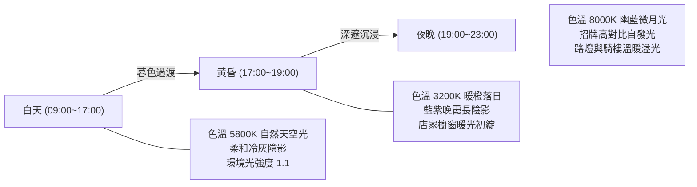

# 《台北劇本殺物語 3D》美術風格規格文件 (Art Specification)

> 版本：v2.1 Art Spec  
> 基準日期：2026-10-21  
> 專案定位：台北真實街景空間感 × 風格化 3D 微縮模型 × 電影感夜霓虹光影

---

## 1. 核心美學原則與色彩調性

### 1.1 設計哲學
- **拒絕通用虛構**：精準捕捉台北特徵（騎樓、二丁掛磁磚、冷氣室外機、不鏽鋼水塔、密集的直立凸出霓虹招牌、機車海）。
- **拒絕無意義寫實**：採用「寫實比例、風格化造型、電影感光影」。幾何塊面保持簡潔有力（Stylized Low-Poly），依靠比例準確與材質層次產生高級感。
- **避免過曝與失焦**：摒棄全畫面泛白的高飽和或重度模糊 Bloom，保留主體清晰度與遊戲可讀性。

### 1.2 色彩方向 (Palette System)
- **夜景基底色**：天幕 `#12121c`、遠處薄霧 `#0e0e16`、柏油路 `#161924`、人行道 `#252a3a`。
- **老街屋立面色**：台北老磁磚深灰藍 `#1b2030`、復古磚紅 `#3d2328`、洗石子冷灰 `#272d40`。
- **自發光亮點色 (High-Contrast Neon Focus)**：
  - 密室/推理冷光：賽博電子青 `#00f5d4`、冰藍 `#38bdf8`
  - 情感/沉浸暖光：洋紅霓虹 `#ff2a85`、夜市琥珀金 `#ffbe0b`
  - 警戒/微恐光澤：深紅 `#ef4444`、幽火紫 `#a855f7`

---

## 2. 尺度與網格標準 (Scale & Grid Metrics)

嚴格按照真實世界人體工學比例建立：

| 測量標的 | 3D 單位 (1 Unit = 1m) | 視覺對應 |
|---|---|---|
| **角色身高** | `1.75 m` | 玩家主角與成人 NPC 標準身高 |
| **頭身比例** | `1 : 5.5` | 典雅風格化比例（兼顧微縮模型可愛感與成熟戲劇感） |
| **標準樓層高度** | `3.2 m` | 台北公寓一層標準淨高 |
| **騎樓行人淨高** | `3.0 m` | 一樓挑高退縮空間 |
| **騎樓深度** | `3.4 m` | 足以容納行人走動、盆栽與店門口排隊 |
| **店面大門尺寸** | `寬 2.4m × 高 2.6m` | 雙扇推拉玻璃門 |
| **主車道寬度** | `11.0 m` | 雙向車道含中央安全距離 |
| **人行道寬度** | `3.0 m` | 人行磚道，高出路面 `0.15m` |
| **直立懸掛招牌** | `寬 0.12m × 高 5.0m × 厚 1.4m` | 伸出建築外牆 `0.8m` |

---

## 3. PBR 材質規範標準 (Material Standard)

所有材質統一使用 `THREE.MeshStandardMaterial`，杜絕不同物體反射率混亂：

| 材質分類 | 粗糙度 (Roughness) | 金屬度 (Metalness) | 透明/發光 (Emissive) | 應用實體 |
|---|---|---|---|---|
| **瀝青柏油路** | `0.92` | `0.08` | 無 | 街道車道主路面 |
| **人行道地磚** | `0.78` | `0.05` | 無 | 灰色人行道路面、路緣石 |
| **老公寓牆面** | `0.70` | `0.08` | 無 | 磁磚立面、水泥粉刷外牆 |
| **大門/窗戶玻璃** | `0.15` | `0.85` | 內透暖光 `emissiveIntensity: 0.6` | 店面玻璃、樓層窗戶 |
| **不鏽鋼水塔** | `0.18` | `0.88` | 無 | 頂樓水塔、招牌金屬支架 |
| **機車車殼烤漆** | `0.35` | `0.20` | 車頭燈自發光 | 停放機車海、車架 |
| **霓虹招牌面板** | `0.20` | `0.10` | 雙面發光 `emissiveIntensity: 0.85` | 直立燈箱、屋頂橫式招牌 |
| **室內家具木紋** | `0.55` | `0.05` | 無 | 接待櫃檯、劇本長桌、書架 |

---

## 4. 三段式動態光影分級 (Lighting & Color Grading)

---

## 5. 四級建模細節預算 (LOD Priority Tier)

- **S 級（主視覺資產，投入最高）**：
  - 14 家劇本殺名店立面、店門入口、直立霓虹招牌、3D 懸浮面具 POI。
  - 玩家角色模型（精緻輪廓、立體外套、鞋履、待機呼吸動畫）。
- **A 級（互動資產）**：
  - 店內接待櫃檯、劇本展示牆、圍讀會議桌椅、對話 NPC。
- **B 級（背景建築街景）**：
  - 騎樓模組、深開窗、冷氣室外機、水塔、機車海、台電變電箱、路障。
- **C 級（遠景資產）**：
  - 外圍大樓塊面輪廓，隱入夜色霧氣中，降低頂點負擔。

---

## 6. 效能預算目標 (Performance Budget)

- **Draw Calls**：控制在 180 次以下（透過幾何重用與共用材質）。
- **三角面總量**：整張台北微縮模型街區控制在 35,000 面以下。
- **FPS 目標**：
  - 桌上型電腦（Chrome / Edge）：**穩定 60 FPS**。
  - 中階行動裝置（iPhone 11+ / Snapdragon 778G+）：**穩定 30~60 FPS**。
- **記憶體占用**：WebGL Context 不超過 120 MB。
