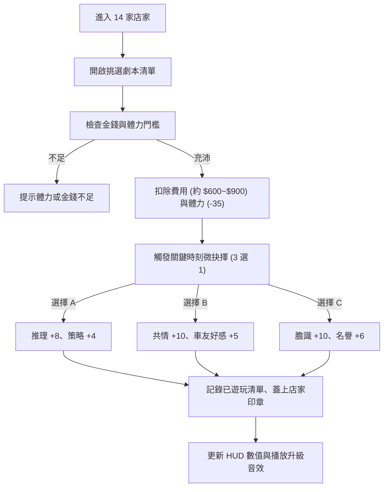

# 《台北劇本殺物語 3D》現有遊戲規則與資料流 (Game Systems)

> 基準版本：v1.0-baseline  
> 盤點時間：2026-10-21

---

## 1. 玩家核心屬性與數值模型

遊戲維護全域狀態物件 `S`（State）：

```javascript
S = {
  month: 1,           // 當前月份 (1 ~ 36，滿 36 月迎向結局評價)
  min: 9 * 60,        // 遊戲時間 (分鐘制，例如 540 = 09:00，上限 23:00)
  money: 1500,        // 金錢 (新台幣 NT$)
  hp: 100,            // 體力 (0 ~ 100)
  logic: 20,          // 推理力 (影響燒腦硬核本及高薪家教)
  heart: 20,          // 共情力 (影響情感本體驗及人物深刻對話)
  nerve: 20,          // 膽識 (影響恐怖微恐本及深夜事件)
  mech: 20,           // 策略力 (影響機制陣營本勝率)
  rep: 50,            // 名譽 (0 ~ 100，影響稱號與圈內聲望)
  played: [],         // 已體驗劇本 ID 清單
  stamps: {},         // 各店家踩點印章紀錄
  mates: {},          // 車友好感度字典 { "九九": 25, ... }
  weather: 'sunny'    // 當前天氣 ('sunny' | 'rainy')
}
```

### 等級與稱號算法
- **能力等級**：`Lv = Math.min(10, Math.floor(stat / 10) + 1)`。例如推理數值 20 為 Lv.2，滿 90 為 Lv.10。
- **名譽稱號**：
  - `>= 85`：【劇本殺傳奇 ★★★★★】
  - `>= 70`：【圈內名流 ★★★★】
  - `>= 50`：【常駐玩家 ★★★】
  - `>= 30`：【進階老手 ★★】
  - `< 30`：【入坑萌新 ★】

---

## 2. 時間與體力循環機制

1. **時間推進**：
   - 移動每秒微量流逝約 0.8 分鐘。
   - 劇本遊玩推進 4 ~ 6 小時。
   - 打工推進 2 ~ 4 小時。
   - 晚上 23:00 後各店家打烊，必須回雅房休息。
2. **月結算與換月（雅房休息）**：
   - 體力回滿至 100。
   - 扣除台北市套房月租 `NT$ 1,000`。
   - 若金錢不足扣除，觸發警告並增加打工壓力。
   - 月份累計 +1，更新隨機天氣（晴天 / 雨天）。

---

## 3. 劇本殺體驗與關鍵抉擇流程 (Script & Dilemma Flow)



---

## 4. 車友系統與好感度羈絆 (Mates Affinity)

- **15 位車友**（Mei, 智, 九九, 比爾, Yuhan, 樂, 大發, 瑄, 露露, 琳琳, Emo鴨, 一安, Lydia, 枰梓, 團子）。
- **好感度提升途徑**：
  - 路上遇見交談（+2 好感度）。
  - 送手搖珍奶（花費 NT$ 65，+8 好感度）。
  - 共同體驗劇本殺並做出默契選擇（+5 ~ +10 好感度）。
- **高好感獎勵**：
  - 解鎖私密車友語錄與專屬頭像框。
  - 組團玩本時獲得折扣或額外屬性加成。

---

## 5. 資料持久化與安全邊界 (Data Persistence)

- **儲存媒介**：`window.localStorage`。
- **存檔鍵名**：`tplarp-3d-save-v1`。
- **儲存內容**：僅序列化乾淨純粹的數值物件 `JSON.stringify(S)`，絕不序列化 3D Mesh、場景或 DOM 節點。
- **隔離安全**：與原版 2D 遊戲（存檔鍵 `tplarp-save-v2`）完全分離，兩者獨立運作，互不污染。
